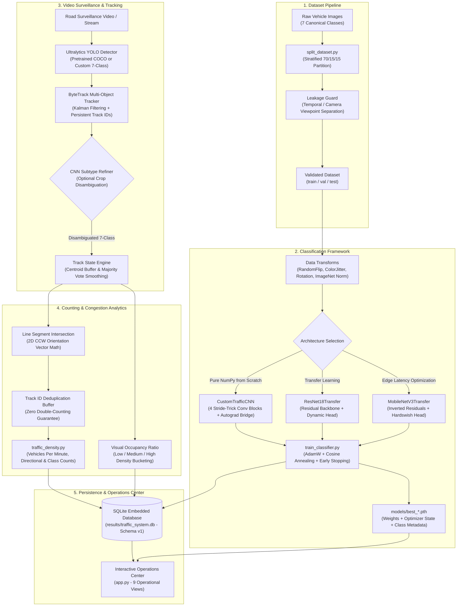

# Smart Traffic Monitoring and Vehicle Classification System

An enterprise-grade, end-to-end computer vision and deep learning system engineered for real-time intelligent traffic surveillance, multi-vehicle classification, multi-object tracking, and virtual line-crossing congestion analytics.

---

## Architecture Pipeline



---

## Project Folder Structure

```
smart-traffic-monitoring/
│
├── .env.example                          # Environment variable configuration template
├── .gitignore                            # Version control exclusion rules
├── pytest.ini                            # Pytest discovery configuration and pythonpath root
├── requirements.txt                      # Production runtime dependencies and pin specs
├── README.md                             # Production documentation and architecture guide
│
├── .streamlit/
│   └── config.toml                       # Streamlit server and custom palette configuration
│
├── config.py                             # Central configuration, canonical classes, paths, heuristics
├── utils.py                              # Diagnostics, hardware inspection, safe JSON I/O, logging
├── database.py                           # SQLite schema v1 migrations and telemetry persistence
├── dataset_utils.py                      # Dataset validation, transforms, weights, synthetic data generator
├── classifier_models.py                  # Custom NumPy CNN engine, ResNet-18, MobileNetV3-Small, checkpoints
├── split_dataset.py                      # Stratified train/val/test splitter with data leakage protection
├── train_classifier.py                   # Model training engine with AdamW, Cosine LR, early stopping
├── evaluate_classifier.py                # Test set evaluation: Confusion Matrix, Macro-F1, per-class stats
├── compare_models.py                     # Side-by-side model benchmarking: Latency, FPS, Params, Accuracy
├── predict_image.py                      # Single vehicle patch inference CLI with uncertainty handling
├── detection.py                          # Ultralytics YOLO vehicle detector with optional CNN crop refiner
├── tracking.py                           # ByteTrack persistent vehicle tracker with temporal class voting
├── traffic_density.py                    # CCW line crossing counter and 2D optical congestion proxy
├── analytics.py                          # Session metrics aggregator, time-series plotting, and report exporter
├── generate_sample_video.py              # Synthetic video generator with moving vehicle targets
├── app.py                                # Production 9-page interactive Streamlit operations center
│
├── data/
│   ├── sample_traffic.mp4                # Synthetically rendered test video
│   ├── raw/                              # Unsplit image folders categorized by class
│   └── processed/                        # Intermediate processing artifacts
│
├── dataset/                              # Partitioned training, validation, and test datasets
│   ├── train/                            # Training splits per vehicle category
│   ├── val/                              # Validation splits per vehicle category
│   └── test/                             # Held-out evaluation test splits per category
│
├── models/                               # Serialized PyTorch checkpoints (*.pth) with metadata
│   ├── best_custom_cnn.pth               # Checkpoint for pure NumPy custom CNN
│   ├── best_resnet18.pth                 # Checkpoint for ResNet-18 transfer backbone
│   └── best_mobilenet_v3_small.pth       # Checkpoint for MobileNetV3-Small transfer backbone
│
├── results/                              # Analytics outputs, evaluation charts, database, and logs
│   ├── traffic_system.db                 # SQLite relational database holding experiments and logs
│   ├── models_comparison.csv             # Multi-model benchmark performance table (CSV)
│   ├── models_comparison.json            # Machine-readable multi-model benchmark results
│   ├── models_comparison_chart.png       # 4-quadrant benchmark visualization (Accuracy, F1, Latency, Params)
│   └── <arch>_confusion_matrix.png       # Normalized confusion matrix heatmaps
│
└── tests/                                # Comprehensive automated unit test suite (26 tests)
    ├── test_classifier.py                # Tests for model forward passes, head shapes, and checkpoint I/O
    ├── test_dataset_utils.py             # Tests for image validation, synthetic data, and stratified splits
    ├── test_evaluation.py                # Tests for metrics calculations, zero-division, and confusion matrices
    └── test_traffic_density.py           # Tests for CCW line intersections, deduplication, and VPM math
```

---

## Exhaustive File-by-File Architecture Breakdown

Every file in the repository serves a distinct operational purpose within the architecture. The table below maps out what work each file performs, its core responsibilities, and how it communicates with adjacent components:

### 1. Core Configuration & System Utilities

#### `config.py`
- **Primary Work:** Acts as the single source of truth for global configuration parameters across the entire repository.
- **Key Responsibilities:**
  - Establishes canonical path resolutions (`PROJECT_ROOT`, `DATASET_DIR`, `MODELS_DIR`, `RESULTS_DIR`) and ensures baseline directory structures exist at module import.
  - Defines the canonical 7-class taxonomy (`auto_rickshaw`, `bicycle`, `bus`, `car`, `motorcycle`, `scooter`, `truck`).
  - Supplies color mappings in BGR (for OpenCV rendering) and Hex (for Matplotlib and Streamlit charts).
  - Specifies training defaults (learning rate `0.001`, batch size `32`, weight decay `1e-4`, early stopping patience `5`).
  - Implements `get_device()` to resolve target compute hardware (`cuda` vs. `cpu`) with automatic fallback.
- **Interactions:** Imported by virtually every script in the pipeline (`train_classifier.py`, `detection.py`, `tracking.py`, `traffic_density.py`, `app.py`).

#### `utils.py`
- **Primary Work:** Provides general-purpose engineering utilities for reproducibility, hardware diagnostics, logging, and robust file I/O.
- **Key Responsibilities:**
  - `set_seed()`: Enforces determinism across Python random, NumPy, and PyTorch, disabling non-deterministic cuDNN benchmark algorithms.
  - `get_device_info()`: Probes system hardware, PyTorch version, active CUDA device name, total VRAM, and compute capability.
  - `save_json()` / `load_json()`: Handles JSON serialization safely, auto-converting NumPy data types, Timestamps, and Path objects to prevent serialization crashes.
  - `calculate_model_parameters()`: Computes total vs. trainable parameter counts for any PyTorch module.
  - `setup_logger()`: Configures clean, standardized console loggers.
- **Interactions:** Consumed by `train_classifier.py`, `evaluate_classifier.py`, `compare_models.py`, `predict_image.py`, and `app.py`.

#### `database.py`
- **Primary Work:** Manages the embedded SQLite database (`results/traffic_system.db`) for tracking machine learning experiments and logging real-time traffic surveillance sessions.
- **Key Responsibilities:**
  - Schema migration management via the `schema_version` table (Version 1).
  - Stores hyperparameter configurations, validation performance, and checkpoint locations in the `experiments` table.
  - Persists multi-model benchmark results in the `model_comparisons` table.
  - Records aggregated video run statistics in `traffic_sessions` and granular frame-by-frame vehicle counts in `traffic_density_logs`.
  - Implements thread-safe context management with automated rollback upon operational exceptions.
- **Interactions:** Populated during model training by `train_classifier.py`, updated during evaluation by `evaluate_classifier.py`, queried by `compare_models.py`, and visualized by `app.py`.

---

### 2. Dataset Management & Synthetic Generation

#### `dataset_utils.py`
- **Primary Work:** Manages data integrity, visual preprocessing pipelines, class imbalance compensation, and synthetic dataset generation.
- **Key Responsibilities:**
  - `is_valid_image()`: Verifies image header integrity and forces raster pixel decoding via Pillow to catch truncated image files.
  - `validate_dataset()`: Analyzes dataset folder structure, checks split consistency (`train`, `val`, `test`), detects unreadable images, and computes class imbalance ratios.
  - `get_data_transforms()`: Constructs PyTorch torchvision transform pipelines (data augmentation with random flips, rotations, and color jitter for training; deterministic resize and ImageNet normalization for validation/test).
  - `compute_class_weights()`: Calculates inverse class frequency weights ($W_c = \frac{N}{C \cdot N_c}$) to counter class imbalance in `nn.CrossEntropyLoss`.
  - `create_synthetic_sample_dataset()`: Procedurally generates synthetic 224x224 RGB vehicle images for all 7 classes with category-specific geometric features (cabins, wheelbases, road textures) to allow out-of-the-box pipeline validation without external data downloads.
- **Interactions:** Utilized by `train_classifier.py`, `evaluate_classifier.py`, `predict_image.py`, `app.py`, and `tests/test_dataset_utils.py`.

#### `split_dataset.py`
- **Primary Work:** Partitions raw class-structured image directories into stratified `train`, `val`, and `test` splits.
- **Key Responsibilities:**
  - Enforces deterministic stratified splitting based on configurable ratios (default 70% train, 15% validation, 15% test).
  - Implements alphabetical path sorting before random shuffling to prevent OS-dependent inode traversal discrepancies across different filesystems.
  - Emits explicit engineering warnings regarding temporal data leakage when handling sequential traffic camera video frames.
  - Safely copies files by default to preserve source data, with an optional `--move` flag.
- **Interactions:** Prepares datasets consumed by `train_classifier.py` and `evaluate_classifier.py`.

---

### 3. Deep Learning Classification Framework

#### `classifier_models.py`
- **Primary Work:** Defines neural network architectures, autograd execution bridges, and checkpoint serialization logic for 7-class vehicle classification.
- **Key Responsibilities:**
  - `CustomTrafficCNN`: A custom convolutional neural network where all forward and backward operations (im2col convolutions using NumPy `sliding_window_view`, batch normalization, ReLU activation, 2x2 max pooling, global average pooling, dropout, and dense projections) are hand-implemented in pure NumPy. Wraps execution in a custom `torch.autograd.Function` bridge while exposing weights as PyTorch `nn.Parameter` references for AdamW optimizer compatibility.
  - `ResNet18Transfer`: Adapts a torchvision ResNet-18 residual backbone by swapping the final fully connected classification head for a dynamic multi-class linear projection with dropout regularization.
  - `MobileNetV3Transfer`: Implements an inverted residual MobileNetV3-Small backbone optimized for mobile and edge inference throughput.
  - `build_classifier()`: Factory function providing a unified instantiation interface across all architectures.
  - `save_checkpoint()` / `load_checkpoint()`: Handles full checkpoint persistence, packaging model weights, class name taxonomies, input dimensions, normalization statistics, validation metrics, and optimizer state.
- **Interactions:** Used by `train_classifier.py`, `evaluate_classifier.py`, `compare_models.py`, `predict_image.py`, `detection.py`, and `tracking.py`.

#### `train_classifier.py`
- **Primary Work:** Orchestrates the model training and validation loop.
- **Key Responsibilities:**
  - Executes mini-batch training and validation passes using `AdamW` and `CosineAnnealingLR` scheduling.
  - Guards against batch-normalization collapse by dropping single-sample trailing batches (`drop_last = True` when `len % batch_size == 1`).
  - Supports class-weighted `CrossEntropyLoss` to prevent dominant classes from biasing gradient updates.
  - Implements early stopping based on validation loss patience to prevent overfitting.
  - Generates training history logs (`.csv`), plots loss and accuracy curves (`.png`), serializes best checkpoints to `models/`, and registers experiment runs in SQLite.
- **Interactions:** Called from CLI or the Streamlit web interface; imports `classifier_models.py`, `dataset_utils.py`, `database.py`, and `config.py`.

#### `evaluate_classifier.py`
- **Primary Work:** Evaluates trained model checkpoints quantitatively against held-out test datasets.
- **Key Responsibilities:**
  - Calculates global Top-1 Accuracy, Macro/Weighted Precision, Recall, and Macro-F1 scores using scikit-learn.
  - Generates per-class evaluation metrics saved to CSV.
  - Computes row-normalized confusion matrices (reflecting class-conditional recall rates independent of test support imbalance) and renders heatmap visualizations (`.png`).
  - Automatically updates test evaluation metrics in the corresponding SQLite experiment record.
- **Interactions:** Invoked directly via CLI, called programmatically by `compare_models.py`, and visualized inside `app.py`.

#### `compare_models.py`
- **Primary Work:** Executes side-by-side benchmarking of multiple model architectures evaluated on the same test set.
- **Key Responsibilities:**
  - Measures steady-state inference latency (ms/image) and throughput (FPS) after executing warmup passes to isolate hardware compute from JIT/memory-allocation overheads.
  - Compares model parameter counts (total vs. trainable) and serialized checkpoint file sizes (MB).
  - Gathers accuracy and Macro-F1 metrics across all candidate models.
  - Produces comparison CSV tables, machine-readable JSON summaries, 4-panel comparison bar charts, and records benchmark comparisons in SQLite.
- **Interactions:** Consumes trained checkpoints produced by `train_classifier.py`; leverages `evaluate_classifier.py` and `utils.py`.

#### `predict_image.py`
- **Primary Work:** CLI and programmatic inference engine for individual vehicle patch classification.
- **Key Responsibilities:**
  - Preprocesses input images (PIL Images, numpy arrays, or file paths) to match checkpoint dimensions and normalization standards.
  - Flushes CUDA streams before and after execution to measure exact hardware inference latency in milliseconds.
  - Generates Top-1 predicted vehicle labels alongside full softmax probability distributions across all classes.
  - Evaluates prediction confidence against configurable uncertainty thresholds to flag ambiguous classifications.
- **Interactions:** Used as a standalone CLI tool, by the Streamlit dashboard, and by `detection.py` and `tracking.py` for secondary crop disambiguation.

---

### 4. Computer Vision, Detection, Tracking & Congestion Analytics

#### `detection.py`
- **Primary Work:** Encapsulates object detection using Ultralytics YOLO models with optional CNN crop refinement.
- **Key Responsibilities:**
  - Interfaces with pretrained YOLOv8/YOLO11 models or custom-trained 7-class weights.
  - Maps standard MS COCO vehicle classes (`car`, `bus`, `truck`, `motorcycle`, `bicycle`) into the project taxonomy, providing explicit warnings regarding COCO's absence of auto-rickshaws and scooters.
  - Provides a secondary CNN Crop Refiner: passes ambiguous vehicle detections (e.g., two-wheelers) to our trained 7-class classifier to accurately classify scooters, auto-rickshaws, and motorcycles.
  - `generate_yolo_dataset_yaml()`: Creates Ultralytics-compatible YAML dataset configuration files for users training custom YOLO detectors.
  - `draw_detections()`: Renders bounding boxes, category tags, confidence percentages, and refinement badges onto OpenCV video frames.
- **Interactions:** Works upstream of `tracking.py`; calls `predict_vehicle_image()` from `predict_image.py`.

#### `tracking.py`
- **Primary Work:** Implements persistent multi-object vehicle tracking across sequential video frames using ByteTrack.
- **Key Responsibilities:**
  - Maintains persistent track IDs and motion trajectory buffers (`deque` of centroid coordinates).
  - Implements temporal class-vote smoothing (`track_class_votes`): tallies frame-by-frame class assignments per track ID to eliminate visual label flickering via majority voting.
  - Integrates optional CNN crop refinement on tracked vehicle bounding boxes.
  - Provides state reset mechanisms to flush internal Kalman filter states when switching video sources.
  - `draw_tracks()`: Visualizes persistent vehicle IDs, motion trails, and centroids on video frames.
- **Interactions:** Consumes raw video frames, delegates association to Ultralytics ByteTrack, and provides active track states to `traffic_density.py`.

#### `traffic_density.py`
- **Primary Work:** Executes virtual line-crossing vehicle counting and computes real-time optical congestion density metrics.
- **Key Responsibilities:**
  - `line_segments_intersect()`: Implements a 2D computational geometry line-crossing test based on Counter-Clockwise (CCW) cross-product orientation. Avoids division-by-zero errors inherent in slope-intercept ($y = mx + b$) methods when vehicle trajectories or cordon lines are vertical.
  - `determine_crossing_direction()`: Computes the 2D vector cross product between the cordon line and the trajectory vector to identify inbound vs. outbound traffic flow.
  - Unique vehicle counting: Tracks processed IDs in a set buffer (`counted_tracks`) to guarantee zero double-counting across the session.
  - Optical density proxy: Computes vehicle counts and 2D bounding-box spatial occupancy ratios relative to the frame/ROI area, bucketing congestion into `Low`, `Medium`, or `High`.
  - Calculates Vehicles Per Minute (VPM) flow rates.
  - `draw_density_overlay()`: Renders the virtual counting line, directional crossing alerts, and a top telemetry HUD onto output frames.
- **Interactions:** Fed by active tracks from `tracking.py`; frame metrics are logged by `analytics.py` and visualized in `app.py`.

#### `analytics.py`
- **Primary Work:** Aggregates video monitoring telemetry, computes session summary statistics, and generates analytical visualizations.
- **Key Responsibilities:**
  - `summarize_traffic_session()`: Computes total unique vehicle counts, predominant congestion levels, average/peak vehicle counts, and duration from frame-level logs, committing session records to SQLite.
  - `generate_session_plots()`: Produces Matplotlib density profile timelines and vehicle category distribution donut charts.
  - `export_session_reports()`: Exports full frame-by-frame telemetry logs to CSV and session metadata to JSON.
- **Interactions:** Consumes frame logs from `traffic_density.py`, interacts with `database.py`, and powers the analytics views in `app.py`.

#### `generate_sample_video.py`
- **Primary Work:** Generates synthetic traffic surveillance video files for out-of-the-box pipeline testing without requiring external video downloads.
- **Key Responsibilities:**
  - Synthesizes a 640x360 MP4 video (`data/sample_traffic.mp4`) at 20 FPS with asphalt road textures and lane markings.
  - Simulates multiple vehicle targets moving bidirectionally across the virtual counting line to test detection, ByteTrack tracking, and line crossing geometry.
- **Interactions:** Produces test media for `detection.py`, `tracking.py`, and `app.py`.

---

### 5. Web Dashboard & Configuration

#### `app.py`
- **Primary Work:** Production-grade 9-page interactive operations center built with Streamlit.
- **Key Responsibilities:**
  - **Dashboard:** System overview displaying compute device information, VRAM capacity, active models, recorded experiments, and pipeline diagrams.
  - **Dataset Check:** Explores dataset directories, runs corruption checks, reports class imbalance, and provides one-click synthetic dataset generation.
  - **Train:** Interactive GUI for configuring hyperparameters, launching model training with real-time epoch progress callbacks, and viewing loss curves.
  - **Compare Models:** GUI to benchmark multiple trained checkpoints side-by-side on identical test sets.
  - **Classify Image:** Single-image classification interface with interactive confidence sliders and probability distribution bar charts.
  - **Video Counting:** Video surveillance interface supporting video upload, configurable counting lines, real-time tracking annotation, and video export.
  - **Traffic Insights:** Displays historical traffic sessions, time-series vehicle count profiles, and vehicle class breakdowns from the SQLite database.
  - **Exports:** One-click CSV downloads of experiment records and traffic monitoring logs.
  - **System & Notes:** Detailed documentation on hardware status, MS COCO mapping limitations, public datasets, and camera calibration notes.
- **Interactions:** Serves as the primary operational UI, coordinating all underlying backend modules.

#### `.streamlit/config.toml`
- **Primary Work:** Configures Streamlit runtime parameters and custom theme styling.
- **Key Responsibilities:**
  - Establishes the visual identity (asphalt background `#1F2326`, concrete workspace `#ECEDEA`, signal green `#1F7A5C`, paint yellow `#F5B700`).
  - Sets the maximum upload file size to 500 MB to support traffic video analysis.
- **Interactions:** Automatically loaded by Streamlit when executing `streamlit run app.py`.

#### `.env.example`
- **Primary Work:** Environment variable template for deployments.
- **Key Responsibilities:**
  - Documents configuration variables (`DEVICE`, `DATABASE_PATH`, `DEFAULT_YOLO_MODEL`, `RANDOM_SEED`, `STREAMLIT_SERVER_PORT`).
- **Interactions:** Copied to `.env` by operators to customize runtime settings.

#### `requirements.txt`
- **Primary Work:** Specifies pinned external package dependencies.
- **Key Responsibilities:**
  - Declares core deep learning frameworks (`torch`, `torchvision`), vision engines (`ultralytics`, `opencv-python`, `pillow`), web UI tools (`streamlit`, `matplotlib`), scientific libraries (`numpy`, `pandas`, `scikit-learn`), and testing frameworks (`pytest`).
- **Interactions:** Used by `pip install -r requirements.txt`.

#### `pytest.ini`
- **Primary Work:** Configures test discovery and execution settings.
- **Key Responsibilities:**
  - Sets `pythonpath = .` so test runners locate project modules without modifying environment variables.
  - Directs test discovery to the `tests/` directory.
- **Interactions:** Read by `pytest`.

---

### 6. Automated Test Suite (`tests/`)

#### `tests/test_classifier.py`
- **Primary Work:** Unit tests verifying classifier model architectures and checkpoint operations.
- **Key Responsibilities:**
  - Validates forward passes for `CustomTrafficCNN`, `ResNet18Transfer`, and `MobileNetV3Transfer`.
  - Verifies dynamic output layer sizing when changing class counts.
  - Verifies model factory error handling on invalid architecture strings.
  - Validates full checkpoint serialization and deserialization roundtrips, confirming parameter integrity and forward pass validity after reloading.
- **Interactions:** Runs with zero network access (`pretrained=False`).

#### `tests/test_dataset_utils.py`
- **Primary Work:** Unit tests verifying image validation, dataset splitting, and augmentation transforms.
- **Key Responsibilities:**
  - Confirms `is_valid_image()` correctly validates clean images while rejecting corrupt byte sequences and unsupported file extensions.
  - Verifies directory validation and error reporting on missing or unpartitioned paths.
  - Validates procedural synthetic dataset generation across all 7 classes.
  - Tests split determinism, confirming identical partitions when seeded and asserting exact 70/15/15 distribution ratios.
- **Interactions:** Tests functions in `dataset_utils.py` and `split_dataset.py`.

#### `tests/test_evaluation.py`
- **Primary Work:** Unit tests for classification evaluation metrics and edge case handling.
- **Key Responsibilities:**
  - Validates metric calculations on perfect predictions (1.0 accuracy, precision, recall, F1).
  - Tests zero-division safety handling when specific classes receive zero predictions.
  - Validates confusion matrix array shapes and cell assignments.
  - Tests the end-to-end evaluation pipeline on a synthetic test directory.
- **Interactions:** Tests functions in `evaluate_classifier.py`.

#### `tests/test_traffic_density.py`
- **Primary Work:** Unit tests for computational geometry, directional tracking, and congestion rate algorithms.
- **Key Responsibilities:**
  - Tests `line_segments_intersect()` for true crossings, parallel non-crossings, and trajectories that stop short.
  - Validates `determine_crossing_direction()` vector math for inbound vs. outbound trajectories.
  - Verifies the deduplication buffer in `TrafficDensityEstimator` to ensure a vehicle crossing a virtual line is counted exactly once.
  - Tests count-based density threshold classifications (`Low`, `Medium`, `High`).
  - Validates Vehicles Per Minute (VPM) rate scaling math.
- **Interactions:** Tests algorithms in `traffic_density.py`.

---

## 7-Class Vehicle Definition & COCO Label Mapping

The system targets **7 canonical vehicle classes**:
1. `auto_rickshaw` (Three-wheeled motorized public/private transport)
2. `bicycle` (Non-motorized pedal cycles)
3. `bus` (Public transit vehicles, coaches)
4. `car` (Passenger sedans, hatchbacks, SUVs)
5. `motorcycle` (Standard motorbikes, cruisers, superbikes)
6. `scooter` (Step-through two-wheelers, e.g., Vespa, Honda Activa)
7. `truck` (Freight carriers, heavy goods vehicles, pickups)

### Pretrained COCO Detector vs. Target 7 Classes

Standard general-purpose object detectors trained on the MS COCO dataset (such as off-the-shelf YOLO models) have inherent limitations in regional and mixed traffic environments:

| Target Class | MS COCO Native Class ID | Mapping Strategy & Limitation |
|---|---|---|
| `car` | Class 2 (`car`) | Direct 1:1 match. |
| `bicycle` | Class 1 (`bicycle`) | Direct 1:1 match. |
| `bus` | Class 5 (`bus`) | Direct 1:1 match. |
| `truck` | Class 7 (`truck`) | Direct 1:1 match. |
| `motorcycle` | Class 3 (`motorcycle`) | **COCO aggregates motorcycles and scooters together.** |
| `scooter` | **None** (Missing in COCO) | Standard COCO models label scooters as `motorcycle`. |
| `auto_rickshaw` | **None** (Missing in COCO) | Standard COCO models frequently misclassify auto-rickshaws as `car` or fail detection entirely. |

### Implemented Solution

1. **Two-Stage Detection + CNN Crop Refinement**: When the YOLO detector identifies a vehicle candidate, its bounding box crop is passed to our trained 7-class CNN classifier. This resolves ambiguous classifications, accurately separating scooters from motorcycles and detecting auto-rickshaws.
2. **Native YOLO Training Configuration**: The system includes a dataset YAML generator (`generate_yolo_dataset_yaml()` in `detection.py`) to streamline training native 7-class YOLO models when bounding-box annotations are available.

---

## Mathematical Foundations & Algorithmic Design

### 1. Pure NumPy Vectorized Convolution (`sliding_window_view`)
The `CustomTrafficCNN` avoids nested Python loops over spatial dimensions $(H, W)$ during convolution. It leverages NumPy's `sliding_window_view` to extract all receptive field patches into a strided tensor view without copying memory, reshaping the input into an `im2col` matrix:

$$\text{cols} \in \mathbb{R}^{(N \cdot H_{\text{out}} \cdot W_{\text{out}}) \times (C_{\text{in}} \cdot K \cdot K)}$$

The spatial convolution collapses into a single General Matrix Multiply (GEMM):

$$\text{out} = \text{cols} \cdot W^T + b$$

During backward propagation, the parameter gradients are accumulated via transpose multiplication:

$$\frac{\partial L}{\partial W} = (\delta_{\text{out}})^T \cdot \text{cols}, \quad \frac{\partial L}{\partial b} = \sum \delta_{\text{out}}$$

### 2. Analytical Batch Normalization Backward Pass
Rather than computing intermediate computational graph nodes, `_NpBatchNorm2D.backward` computes the analytical gradient directly:

$$\frac{\partial L}{\partial x_i} = \frac{\gamma}{m \cdot \sqrt{\sigma^2 + \epsilon}} \left( m \cdot \frac{\partial L}{\partial y_i} - \sum_{j=1}^m \frac{\partial L}{\partial y_j} - \hat{x}_i \sum_{j=1}^m \frac{\partial L}{\partial y_j} \hat{x}_j \right)$$

This eliminates numerical instability and reduces memory allocations.

### 3. Computational Geometry Line Intersection (CCW Orientation)
To detect whether a vehicle centroid trajectory from point $A$ to point $B$ crossed a virtual cordon line from point $C$ to point $D$, we evaluate Counter-Clockwise (CCW) orientation:

$$\text{CCW}(P_1, P_2, P_3) = (y_3 - y_1)(x_2 - x_1) > (y_2 - y_1)(x_3 - x_1)$$

Segment $AB$ intersects segment $CD$ if and only if points $A$ and $B$ are separated by line $CD$, and points $C$ and $D$ are separated by line $AB$:

$$\text{Intersect}(AB, CD) = (\text{CCW}(A, C, D) \neq \text{CCW}(B, C, D)) \land (\text{CCW}(A, B, C) \neq \text{CCW}(A, B, D))$$

This method requires zero division operations, preventing `ZeroDivisionError` exceptions on vertical trajectories or cordon lines.

### 4. Inverse Class Frequency Weighting
To combat training bias in imbalanced datasets, loss weights for class $c$ are computed as:

$$W_c = \frac{N}{C \cdot N_c}$$

where $N$ is the total training sample count, $C$ is the number of classes, and $N_c$ is the sample count for class $c$.

### 5. Optical Density Proxy vs. Physical Density
- **Optical Density Proxy (Implemented):** Combines instantaneous active vehicle counts and the 2D bounding-box spatial occupancy ratio:
  $$\text{Occupancy Ratio} = \min\left(1.0, \frac{\sum \text{Area}(\text{Box}_i)}{\text{Area}(\text{ROI})}\right)$$
  Classified into `Low`, `Medium`, or `High` based on empirical field-of-view thresholds.
- **Physical Road Density (Scientific Limitation):** Measuring true physical traffic density (vehicles per lane-kilometer) or speed (km/h) requires a calibrated 3D-to-2D planar homography matrix $H$ and ground-plane distance markers. This project strictly avoids fabricating uncalibrated speed metrics.

---

## Environment Setup & Hardware Configuration

### Prerequisites
- Windows 10/11, Linux, or macOS
- Python 3.10, 3.11, 3.12, or 3.13
- Optional: NVIDIA GPU with CUDA 11.8+ or 12.1+

### Installation

1. **Activate virtual environment**:
   ```powershell
   python -m venv venv
   .\venv\Scripts\Activate.ps1
   ```

2. **Install dependencies**:
   ```bash
   pip install -r requirements.txt
   ```

3. **Verify hardware configuration**:
   ```bash
   python -c "import torch; print('CUDA Available:', torch.cuda.is_available()); print('Device:', torch.cuda.get_device_name(0) if torch.cuda.is_available() else 'CPU')"
   ```

---

## Step-by-Step Operational Guide

### 1. Execute Automated Test Suite
Run the 26 unit tests covering architectures, geometry, dataset validation, and metrics:
```bash
pytest
```

### 2. Dataset Preparation

#### Option A: Generate Synthetic Sample Dataset (7 Classes)
Generate a synthetic dataset with distinct visual features to test the pipeline immediately:
```bash
python -c "from dataset_utils import create_synthetic_sample_dataset; create_synthetic_sample_dataset('dataset', samples_per_class=14)"
```

#### Option B: Split Real Raw Images into Train / Val / Test
Organize raw images as `data/raw/<class_name>/*.jpg` and partition them:
```bash
python split_dataset.py --source data/raw --destination dataset --train-ratio 0.70 --val-ratio 0.15 --test-ratio 0.15 --seed 42
```

### 3. Model Training

#### Train Custom CNN (Pure NumPy Engine from Scratch)
```bash
python train_classifier.py --data-dir dataset --arch custom_cnn --epochs 20 --batch-size 32 --lr 0.001
```

#### Train ResNet-18 (Transfer Learning Baseline)
```bash
python train_classifier.py --data-dir dataset --arch resnet18 --epochs 15 --batch-size 32 --lr 0.0005
```

#### Train MobileNetV3-Small (Edge Latency Baseline)
```bash
python train_classifier.py --data-dir dataset --arch mobilenet_v3_small --epochs 15 --batch-size 32 --lr 0.001
```

Checkpoints are saved to `models/`, training curves are saved to `results/`, and experiment details are logged to SQLite (`results/traffic_system.db`).

### 4. Model Evaluation on Held-Out Test Set
```bash
python evaluate_classifier.py --checkpoint models/best_custom_cnn.pth --test-dir dataset/test
```
Outputs:
- Accuracy, Macro-Precision, Macro-Recall, Macro-F1
- Confusion matrix heatmap: `results/<arch>_confusion_matrix.png`
- Per-class metrics CSV: `results/<arch>_per_class_metrics.csv`
- Machine-readable JSON report: `results/<arch>_test_metrics.json`

### 5. Multi-Model Benchmark Comparison
Benchmark multiple trained models on the exact same test dataset:
```bash
python compare_models.py --checkpoints models/best_custom_cnn.pth models/best_mobilenet_v3_small.pth --test-dir dataset/test
```

### 6. Single Image Inference
Classify an isolated vehicle patch:
```bash
python predict_image.py --checkpoint models/best_custom_cnn.pth --image dataset/test/car/car_test_000.png --threshold 0.50
```

### 7. Launch Interactive Dashboard
Run the 9-page Streamlit operations center:
```bash
streamlit run app.py
```
Open your browser at `http://localhost:8501`.
