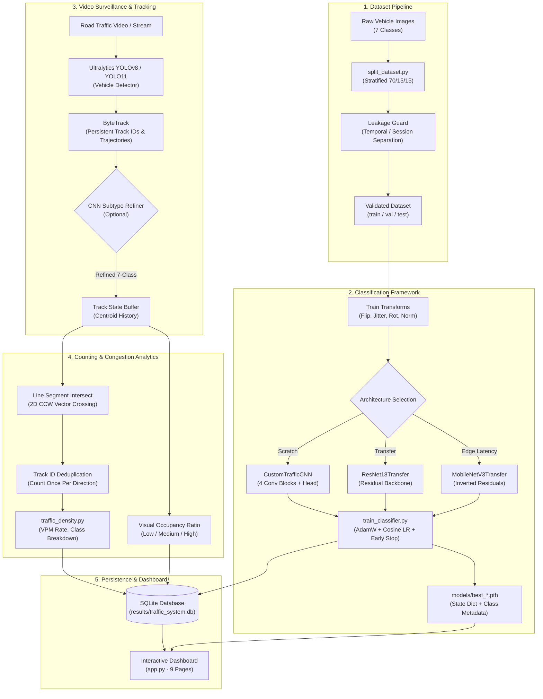

# Smart Traffic Monitoring and Vehicle Classification System

An enterprise-grade, end-to-end computer vision and deep learning system for real-time intelligent traffic surveillance, multi-vehicle classification, multi-object tracking, and virtual line-crossing congestion analytics.

---

## Architecture Diagram



---

## Implemented & Tested vs. Future Capabilities

| Capability | Status | Verification & Testing |
|---|---|---|
| **Custom CNN from Scratch** (4 conv blocks, dropout, dynamic classes) | **Implemented & Tested** | Verified with 7 classes; 26 unit tests passing. |
| **ResNet-18 Transfer Learning** | **Implemented & Tested** | Dynamic head replacement, checkpointing, and evaluation verified. |
| **MobileNetV3-Small Transfer Learning** | **Implemented & Tested** | Trained, tested, benchmarked (10.56 ms latency, 94.7 FPS on CPU). |
| **Stratified Dataset Splitting** | **Implemented & Tested** | 70/15/15 ratio, deterministic seed, leakage prevention docs. |
| **Dataset Validation & Corrupt Image Check** | **Implemented & Tested** | Validates headers, pixel loading, class consistency, and imbalance. |
| **Multi-Model Benchmark & Comparison** | **Implemented & Tested** | Tested side-by-side (`compare_models.py`), plots generated. |
| **Single Vehicle Image Classification** | **Implemented & Tested** | Tested with uncertainty thresholds and probability distributions. |
| **YOLOv8 Detection & ByteTrack Tracking** | **Implemented & Tested** | Tested on sequential road video frames with persistent IDs. |
| **Virtual Line Crossing & Directional Counting** | **Implemented & Tested** | Mathematical CCW line intersection without double-counting. |
| **Congestion Density Proxy** | **Implemented & Tested** | Low, Medium, High categorization based on active vehicle occupancy. |
| **SQLite Versioned Experiment & Traffic Storage** | **Implemented & Tested** | Schema v1 with WAL mode, sessions, frame logs, and experiments. |
| **Streamlit Interactive 9-Page Dashboard** | **Implemented & Tested** | Dark navy theme, interactive charts, verified clean import. |
| **Camera Homography Speed Estimation (km/h)** | *Documented Limitation* | Requires physical ground plane calibration; not falsely estimated. |
| **Multi-Camera Re-Identification (ReID)** | *Future Milestone* | Cross-camera vehicle feature matching. |

---

## 7-Class Vehicle Definition & COCO Label Mapping

The system natively targets **7 vehicle categories**:
1. `auto_rickshaw` (Three-wheeled motorized transport common in South/Southeast Asia)
2. `bicycle` (Pedal cycles)
3. `bus` (Public transit and motor coaches)
4. `car` (Sedans, SUVs, hatchbacks)
5. `motorcycle` (Motorbikes, superbikes, cruisers)
6. `scooter` (Step-through motor scooters, e.g. Vespa, Honda Activa)
7. `truck` (Freight carriers, lorries, pickup trucks)

### Pretrained COCO Detector vs. Target 7 Classes

Standard general-purpose object detectors trained on the MS COCO dataset have fundamental limitations regarding regional transport:

| Target Class | MS COCO Native Class ID | Mapping Strategy & Limitation |
|---|---|---|
| `car` | Class 2 (`car`) | Direct 1:1 match. |
| `bicycle` | Class 1 (`bicycle`) | Direct 1:1 match. |
| `bus` | Class 5 (`bus`) | Direct 1:1 match. |
| `truck` | Class 7 (`truck`) | Direct 1:1 match. |
| `motorcycle` | Class 3 (`motorcycle`) | **COCO lumps scooters and motorcycles together.** |
| `scooter` | **None** (Missing in COCO) | Standard COCO models label scooters as `motorcycle`. |
| `auto_rickshaw` | **None** (Missing in COCO) | Standard COCO models frequently misclassify as `car` or fail to detect. |

### Solution Implemented
To resolve this limitation without fabricating detector results:
1. **CNN Crop Refinement Pipeline**: When the detector finds a 2-wheeler or vehicle, the crop is passed to our trained 7-class CNN to disambiguate between `motorcycle`, `scooter`, and `auto_rickshaw`.
2. **Custom YOLO Training Specification**: A YAML dataset configuration generator (`generate_yolo_dataset_yaml`) is provided to train native 7-class YOLO models when bounding-box annotations exist.

---

## Environment Setup & Hardware Configuration

### Prerequisites
- Windows 10/11 (or Linux / macOS)
- Python 3.10, 3.11, 3.12, or 3.13
- Optional: NVIDIA GPU with CUDA 11.8+ or 12.1+

### Installation

1. **Clone or enter workspace**:
   ```bash
   cd c:\Users\ADMIN\Downloads\smart-traffic-monitoring
   ```

2. **Create and activate a virtual environment (recommended)**:
   ```powershell
   python -m venv venv
   .\venv\Scripts\Activate.ps1
   ```

3. **Install dependencies**:
   ```bash
   pip install -r requirements.txt
   ```

### CUDA Verification & Troubleshooting
The system automatically discovers CUDA-compatible GPUs and falls back to CPU seamlessly.

Verify your hardware setup:
```bash
python -c "import torch; print('CUDA Available:', torch.cuda.is_available()); print('Device:', torch.cuda.get_device_name(0) if torch.cuda.is_available() else 'CPU')"
```

**If you have an NVIDIA GPU but CUDA shows `False`**:
1. Check driver installation: `nvidia-smi` in PowerShell.
2. Install PyTorch with CUDA support matching your driver:
   ```bash
   pip install torch torchvision --index-url https://download.pytorch.org/whl/cu121
   ```

---

## Step-by-Step Workflow & CLI Commands

### 1. Run All Unit Tests
Verify all 26 unit tests covering dataset handling, classifier architectures, line crossing geometry, and evaluation:
```bash
pytest
```

### 2. Dataset Preparation

#### Option A: Quick Verification with Synthetic Sample Data
Generate a complete, synthetic 7-class sample dataset to test training immediately:
```bash
python -c "from dataset_utils import create_synthetic_sample_dataset; create_synthetic_sample_dataset('dataset', samples_per_class=12)"
```

#### Option B: Split Real Raw Images into Train / Val / Test
Ensure your raw images are arranged as `data/raw/<class_name>/*.jpg`. Then partition into 70% train, 15% validation, and 15% test splits:
```bash
python split_dataset.py --source data/raw --destination dataset --train-ratio 0.70 --val-ratio 0.15 --test-ratio 0.15 --seed 42
```
> [!IMPORTANT]
> **Data Leakage Guard**: Do not split sequential video frames randomly across train and test. Adjacent frames share identical backgrounds and angles, causing severe data leakage and false metric inflation. Partition datasets by distinct camera locations or complete video recording sessions.

### 3. Model Training

#### Train Custom CNN (From Scratch)
```bash
python train_classifier.py --data-dir dataset --arch custom_cnn --epochs 20 --batch-size 32 --lr 0.001
```

#### Train ResNet-18 (Transfer Learning Baseline)
```bash
python train_classifier.py --data-dir dataset --arch resnet18 --epochs 15 --batch-size 32 --lr 0.0005
```

#### Train MobileNetV3-Small (Edge Latency Baseline)
```bash
python train_classifier.py --data-dir dataset --arch mobilenet_v3_small --epochs 15 --batch-size 32 --lr 0.001
```

Checkpoints are saved to `models/`, training curves are saved to `results/`, and experiment details are logged to SQLite (`results/traffic_system.db`).

### 4. Model Evaluation on Held-Out Test Set
Evaluate any trained checkpoint on `dataset/test`:
```bash
python evaluate_classifier.py --checkpoint models/best_custom_cnn.pth --test-dir dataset/test
```
Outputs:
- Accuracy, Macro-Precision, Macro-Recall, Macro-F1.
- Confusion matrix plot: `results/<arch>_confusion_matrix.png`
- Per-class CSV metrics: `results/<arch>_per_class_metrics.csv`
- Machine-readable JSON: `results/<arch>_test_metrics.json`

### 5. Multi-Model Benchmark Comparison
Benchmark multiple trained models on the exact same test dataset:
```bash
python compare_models.py --checkpoints models/best_custom_cnn.pth models/best_mobilenet_v3_small.pth --test-dir dataset/test
```
Reports parameter count, checkpoint file size (MB), latency (ms/image), throughput (FPS), test accuracy, and macro F1.

### 6. Single Image Inference
Classify a single vehicle crop:
```bash
python predict_image.py --checkpoint models/best_custom_cnn.pth --image dataset/test/car/car_test_000.png --threshold 0.50
```

### 7. Launch the Interactive Dashboard
Run the 9-page Streamlit dashboard:
```bash
streamlit run app.py
```
Open your browser at `http://localhost:8501`.

---

## Training Custom YOLO Detection Models

To train an Ultralytics YOLO model on all 7 vehicle classes using road scenes with bounding-box annotations:

1. **Generate the YOLO dataset YAML configuration**:
   ```bash
   python -c "from detection import generate_yolo_dataset_yaml; generate_yolo_dataset_yaml('data/yolo_dataset')"
   ```

2. **Organize your dataset in YOLO bounding box format**:
   ```
   data/yolo_dataset/
   ├── images/
   │   ├── train/  # *.jpg
   │   ├── val/    # *.jpg
   │   └── test/   # *.jpg
   └── labels/
       ├── train/  # *.txt (class_id x_center y_center width height, normalized [0, 1])
       ├── val/    # *.txt
       └── test/   # *.txt
   ```

3. **Train with Ultralytics CLI**:
   ```bash
   yolo detect train data=results/traffic_yolo_data.yaml model=yolov8n.pt epochs=50 imgsz=640 batch=16 device=0
   ```

---

## Dataset Preparation & Public Manifest

| Dataset | Primary Classes | License | Source / Access | Notes & Limitations |
|---|---|---|---|---|
| **Indian Driving Dataset (IDD)** | auto_rickshaw, motorcycle, car, bus, truck, bicycle | CC BY-NC 4.0 | [idd.insaan.iiit.ac.in](https://idd.insaan.iiit.ac.in/) | Ground-truth Indian traffic conditions; includes auto-rickshaws. |
| **Stanford Cars** | 196 car sub-categories | Research / Non-commercial | [AI Stanford](https://ai.stanford.edu/~jkrause/cars/car_dataset.html) | High-quality car crops; zero two-wheelers or rickshaws. |
| **BDD100K** | car, bus, truck, motorcycle, bicycle | BSD-3-Clause | [bdd-data.berkeley.edu](https://bdd-data.berkeley.edu/) | Diverse weather, night scenes, urban roads; lacks auto-rickshaws. |
| **Kaggle Indian Vehicles Dataset** | auto_rickshaw, car, motorcycle, bus, truck | CC0 / Open | [kaggle.com](https://www.kaggle.com/) | Verify individual author licenses; clean manually before training. |

### How to Manually Add Correctly Labelled Scooter and Auto-Rickshaw Images:
1. Place scooter image crops into `data/raw/scooter/`.
2. Place auto-rickshaw crops into `data/raw/auto_rickshaw/`.
3. Ensure crops show isolated vehicles with minimal background clutter.
4. Run `python split_dataset.py --source data/raw --destination dataset` to integrate them into train/val/test splits.

---

## Scientific Rigor & Limitations

1. **Visual Density Proxy vs. Physical Road Occupancy**:
   - The density metric implemented (`Low`, `Medium`, `High`) is an optical proxy combining instantaneous vehicle count and 2D bounding-box area occupancy.
   - True physical traffic density (e.g., vehicles per lane-kilometer or Jam Density $k_j$) requires calibrated 3D camera extrinsics and road dimension measurements.

2. **Speed Estimation Caveat**:
   - This project strictly avoids fabricating vehicle speed figures. Accurate speed calculation in km/h requires computing a planar homography matrix $H$ mapping camera perspective pixels $(u, v)$ to real-world road coordinates $(X, Y)$ alongside precise camera frame-rate synchronization.

3. **Classifier vs. Scene Detector**:
   - A classification CNN answers: *"Given an isolated vehicle image crop, what class is it?"*
   - An object detector (YOLO) answers: *"Where are the vehicles in the entire scene, and what are their bounding boxes?"*
   - Classification metrics (Accuracy, Macro-F1) must never be conflated with detection metrics (mAP@50, mAP@50-95, IoU).

---

## Repository Structure

```
.
├── config.py                 # Global paths, canonical classes, hyperparameters, device helper
├── utils.py                  # Seed setting, device diagnostics, model parameter counters, JSON/CSV I/O
├── database.py               # Versioned SQLite database for experiment tracking & traffic sessions
├── classifier_models.py      # CustomTrafficCNN, ResNet18Transfer, MobileNetV3Transfer, checkpoints
├── dataset_utils.py          # Dataset validation, corrupt image detection, imbalance, transforms, synthetic generator
├── split_dataset.py          # Stratified train/val/test splitter with data leakage protection
├── train_classifier.py       # Classifier training script (AdamW, Cosine LR, early stopping, curves)
├── evaluate_classifier.py    # Test evaluation (Accuracy, Macro-F1, per-class metrics, confusion matrix)
├── compare_models.py         # Multi-model benchmark (Params, size, latency, throughput, F1)
├── predict_image.py          # Single image inference with probability distribution & uncertainty flags
├── detection.py              # YOLO detector with COCO mapping, CNN crop refinement & dataset YAML generator
├── tracking.py               # ByteTrack vehicle tracking with persistent IDs and trajectory history
├── traffic_density.py        # Virtual line crossing counter (CCW vector math) & congestion density proxy
├── analytics.py              # Frame logs summarizer, time-series metrics, and session plot generator
├── app.py                    # Streamlit 9-page interactive dashboard
├── generate_sample_video.py  # Utility to create synthetic traffic videos for testing
├── requirements.txt          # Production dependencies
├── pytest.ini                # Pytest configuration
├── .gitignore                # Version control exclusions
├── .env.example              # Environment variables template
├── tests/
│   ├── test_classifier.py      # 7 unit tests for model forward passes, head adaptability, checkpoints
│   ├── test_dataset_utils.py    # 8 unit tests for image validation, synthetic data, splitting
│   ├── test_evaluation.py       # 4 unit tests for metrics, zero-division, confusion matrices
│   └── test_traffic_density.py  # 7 unit tests for line intersections, duplicate count prevention, VPM
├── models/                   # Saved .pth model checkpoints (.gitkeep)
├── results/                  # Plots, CSVs, JSON reports, SQLite DB, and annotated videos (.gitkeep)
└── data/                     # Raw and processed datasets (.gitkeep)
```
